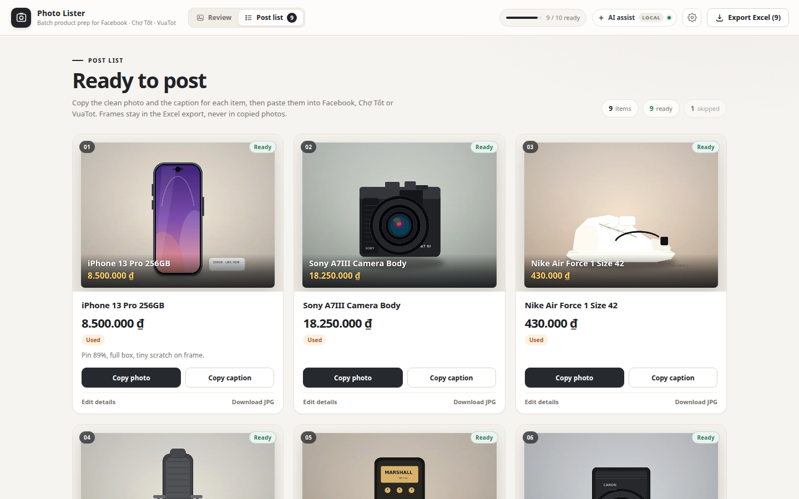

# Photo Lister

A fast, local-first batch lister for preparing product photos for **Facebook Marketplace, Chợ Tốt, VuaTot** and similar marketplaces. Load a folder of photos, review them one by one with big previews, let optional AI fill in a name and a sensible Vietnamese second-hand price, polish the images, then copy clean photos and captions from the in-app **post list**. Excel export is still there when you need a spreadsheet.



## Why it is built this way

- **Post-ready, not spreadsheet-first.** The main output is a clean photo plus a caption you can paste straight into a marketplace composer.
- **Local-first.** Photos stay in the browser. The default "AI" is a deterministic local price/title model that never uploads anything.
- **Fast by design.** Enter saves and advances. The next photo is always one keystroke away.
- **No install/build step.** Plain HTML/CSS/JS. Run it locally with the included Node static server, or host the folder on GitHub Pages and use it from any device.

## Quick start

Requirements: Node.js 18+ (Node 20+ recommended), npm.

```bash
cd photo-lister
npm install
npm start
```

Open **http://127.0.0.1:4173**.

Click **Load demo photos** to try the full flow with ten generated sample products, or **Add photos** / **Folder** to import your own. You can also drag and drop images anywhere in the window.

> The demo images are synthetic illustrations produced by `tools/make_samples.py`, so the repository has no third-party photo licensing concerns.

## Host it on GitHub Pages (free)

The app is fully static, so GitHub Pages can serve it with no server, build step or install. That gives you a stable `https://<user>.github.io/photo-lister/` URL to open on any device.

**One-time setup**

1. Create a **public** GitHub repository (Pages on free accounts requires a public repo).
2. Push this folder to the repository's `main` branch. `node_modules/` and `test-output/` are ignored by `.gitignore`.
3. In the repository: **Settings → Pages → Build and deployment → Deploy from a branch**, then choose **`main`** and **`/ (root)`**. Save.
4. Wait for the Pages build, then open `https://<user>.github.io/photo-lister/`.

The included `.nojekyll` file tells GitHub Pages to publish the files as-is. All asset paths are relative, so the app works from a project subpath like `/photo-lister/`, not only from a custom domain root.

**Using it**

- Photos are read in the browser and never uploaded. Each device keeps its own batch and drafts in local storage; there is no cross-device sync.
- HTTPS on GitHub Pages means clipboard photo copying works in Chrome, Edge and Safari.
- Cloud AI mode calls your configured endpoint directly from the browser. If the endpoint does not allow browser CORS requests, use the default **Local estimates** mode.
- The page itself is publicly reachable. Do not put an API key on a shared or untrusted device; use local mode there.

**Updating the hosted app**

Commit and push changes to `main`; GitHub Pages redeploys automatically.

## The review workflow

1. **Import** a multi-selection or a whole folder. Duplicate files (same name + size + modified time) are ignored. HEIC can't be decoded by most browsers; convert to JPEG/PNG/WebP first.
2. **Review each photo** in the large preview. Fields: product name, price, condition, optional notes.
3. **Accept or edit suggestions.** When local AI assist is on and the fields are empty, a title and price estimate are filled automatically. The suggestion card shows the detected model, condition-adjusted range and the source. You can re-suggest at any time, or dismiss the card.
4. **Press Enter** (or **Save & next**) to keep the values and advance. The filmstrip marks finished items.
5. **Re-suggest or adjust.** A manual **Suggest name & price** proposes values in the card; click **Use suggestion** to apply them, so your own edits are never overwritten by surprise. **Undo** restores the values from before the suggestion, and the **×** dismisses the card.
6. **Polish images** in the **Image** tab if you want auto-enhance, an Excel-only frame, or a name/price overlay. Settings apply to the whole batch; one photo can opt out with **Skip processing for this photo**.
7. **Open the post list** in the top bar. Every non-skipped item appears as a card with its clean photo, price, condition and notes. **Copy photo** and **Copy caption**, then paste into Facebook / Chợ Tốt. **Export Excel** remains available as an optional spreadsheet.

### Keyboard shortcuts

| Key | Action |
| --- | --- |
| `Enter` | Save current values and go to the next photo |
| `Shift` + `Enter` | Save current values and go back |
| `Ctrl`/`Cmd` + `Enter` | Save and advance while typing in the Notes box |
| `Alt` + `←` / `→` | Previous / next |
| `S` | Skip the current photo (when not typing in a field) |

On the last photo, **Save & next** wraps up with a "post list is ready" toast.

### Price input

The price field accepts the way Vietnamese sellers actually type:

- `450k`, `1k5`
- `4.5tr`, `4tr5`, `1tr250`, `4,5 triệu`
- `4.500.000`, `4 500 000`, `12.900.000đ`
- `2 tỷ`

A live hint below the field shows the parsed amount, e.g. `= 8.500.000 ₫`.

### Conditions and prices

Conditions are **New**, **Like new**, **Used** and **For parts**. Condition changes immediately re-price the local suggestion when the price is still automatic (a manually typed price is never overwritten). All estimates are deliberately rough — they are a starting point, not an appraisal.

## AI assist

### Local (default, private)

`src/suggest.js` parses the filename and notes for brand/model/category, then combines a Vietnamese second-hand base price with a storage multiplier, condition multiplier and a small deterministic variation. It recognizes common phones, tablets, laptops, audio gear, consoles, cameras/lenses, and falls back to category ranges for everything else. Nothing leaves the machine, and the same filename always produces the same suggestion.

### Cloud vision (optional)

In **Settings → AI suggestions → Cloud vision AI**, choose a preset (OpenAI, OpenRouter, Ollama) or enter any OpenAI-compatible chat-completions endpoint, model name and API key. **Test connection** verifies the endpoint. Requests go directly from your browser to that endpoint.

- Only the **current photo**, downscaled to a small JPEG, is sent — never the whole folder.
- Product name and price are requested as strict JSON; if the call fails, the local estimate remains available.
- The API key is stored in this browser's `localStorage`. On a shared machine, clear it after use.
- Ollama's OpenAI-compatible endpoint works locally for a fully offline cloud-style option.

Cloud AI is off by default.

## Image processing

The **Image** tab processes on-device with Canvas:

- **Auto-enhance** — brightness/contrast/saturation lift plus unsharp masking. Strength slider 0–100%.
- **Frame** — decorative border for Excel thumbnails only. Five colour presets and adjustable width.
- **Text overlay** — product name and/or price, bottom or top gradient, adjustable text size.
- **Skip processing for this photo** — keeps the original for one item.

The processed image is what appears in the review preview and is copied to the post list. Frames are deliberately excluded from post-list copies, so pasted photos stay clean; the Excel export still uses the frame. The **Original/Processed** toggle lets you compare without changing data. Full-resolution originals are never written to storage or included in the `.xlsx`; thumbnails are capped around 112×80 px in the sheet.

## Post list and copying

The **Post list** view (top bar) is the default finishing step:

- One card per non-skipped photo, in batch order. A green **Ready** badge means the item was saved with Enter; **Draft** items are still included so nothing is lost.
- **Copy photo** puts a full-size clean PNG on the clipboard. Auto-enhance and the text overlay are applied; the frame is not. Paste directly into a Facebook post, Chợ Tốt listing or chat.
- **Copy caption** copies the name, formatted price, condition and notes as plain text:
  ```
  iPhone 13 Pro 256GB
  8.500.000 ₫ · Like new (Như mới)

  Full box, tiny scratch on the frame.
  ```
- **Download JPG** saves the same clean image at up to 2200 px, named from the product title.
- **Edit details** jumps back to the review screen with that item selected.

Clipboard image writing needs a secure context (`http://127.0.0.1` counts) and a browser that supports `ClipboardItem`. When copying is unavailable, the photo is downloaded instead with a toast explaining the fallback. If photo permissions are blocked, use **Download JPG**.

## Excel export (optional)

The workbook contains one **Products** worksheet:

| Image | Product Name | Price | Condition | Notes | Original Filename |
| --- | --- | --- | --- | --- | --- |
| embedded JPEG thumbnail | title | numeric VND, formatted `#,##0 ₫` | New / Like new / Used / For parts | free text (wrapped) | source filename |

Extras: frozen header row, autofilter, zebra rows, condition colour coding, landscape print setup with page numbers. Rows are tall enough for the thumbnails. The export is generated fully client-side with the vendored **ExcelJS** bundle, then downloaded as `products-YYYY-MM-DD-HHmm.xlsx`.

Only non-skipped items are exported. Items with no price still export (price cell blank) and trigger a warning toast with the count.

## Drafts and privacy

- **Photos are never stored** in `localStorage`, IndexedDB or on a server. They exist only as in-memory blobs/bitmaps for the current tab.
- **Draft text** (name, price, condition, notes) is auto-saved in `localStorage`, keyed by filename + size + last-modified. Reload the page, re-add the same folder, and your typing comes back with a "drafts restored" toast.
- **Settings** (AI mode, endpoint, key, image options) are stored locally as well.
- Clear draft text from **Settings → Saved drafts → Clear all saved draft text**.
- The app server binds to `127.0.0.1` only and serves static files; it does not receive or store photos or form data.

## Tests and verification

```bash
npm test          # unit + workbook tests (parse, suggestions, XLSX media)
npm run test:e2e  # full browser flow, exports a real .xlsx and inspects it
```

The E2E suite uses Playwright Core. If Playwright's own Chromium isn't downloaded yet:

```bash
npx playwright-core install chromium
```

Screenshots from the last run are in `screenshots/`; exported/inspected workbooks are in `test-output/`:

- `test-output/e2e-export.xlsx` — 9 products, 9 embedded images, one skipped photo excluded.
- `test-output/export-test.xlsx` — unit-test workbook with three rows and two images.

The E2E test covers: demo import, local title/price prefill, price parsing, Enter/Shift+Enter navigation, skip, image processing and original/processed comparison, settings dialog, the in-app post list, clipboard photo/caption copy, optional Excel export and workbook verification, and draft restore after reload.

## Project layout

```
photo-lister/
├── index.html            # UI markup
├── styles.css            # all styling, responsive layout
├── .nojekyll              # GitHub Pages: serve files as-is
├── server.js             # local static server (127.0.0.1:4173)
├── src/
│   ├── main.js           # state, import, review flow, post list, export
│   ├── parse.js          # Vietnamese price parsing, filename cleanup, categories
│   ├── post.js           # post captions and download filenames
│   ├── suggest.js        # local title/price model
│   ├── imaging.js        # Canvas enhance/frame/overlay pipeline
│   ├── ai.js             # OpenAI-compatible vision client
│   └── export-xlsx.js    # styled workbook + embedded thumbnails
├── vendor/exceljs.min.js # vendored ExcelJS browser bundle
├── samples/              # ten synthetic demo photos + manifest
├── tools/make_samples.py # regenerates the demo photos
├── test/                 # node:test unit/xlsx tests + Playwright E2E
├── screenshots/          # last E2E screenshots
└── test-output/          # last generated workbooks
```

## Regenerating demo images

```bash
npm run samples   # requires Python 3 + Pillow
```

## Limitations

- Browsers cannot decode HEIC/HEIF directly; convert iPhone originals to JPEG first.
- Very large batches (hundreds of photos) keep all source files in memory. 10–50 photos is the intended range.
- Clipboard image copy depends on browser support; the app downloads the image as a fallback.
- The local price model is a heuristic, not live market data. Always sanity-check prices before publishing.
- Browsing data is per device: drafts and the current batch are not synced between phone, tablet and desktop.
- Cloud AI output depends on the model; the prompt asks for JSON, but malformed replies fall back to local estimates.
- The app is a local tool: there is no multi-user sync, server-side database, or background upload queue.
- Excel thumbnails are compressed previews, not print-resolution images.

## License

MIT. Demo images are generated and may be used freely.
